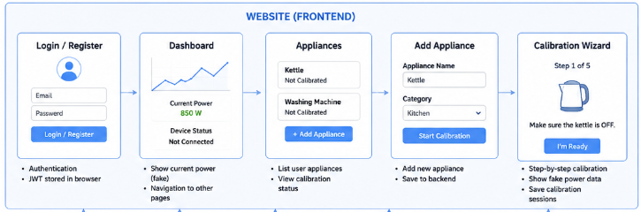

# Website Details

> **Converted verbatim** — one of the three original team documents.
> The wording is the team's; only formatting was changed (headings, lists,
> spacing). Do not edit this file to reflect new decisions.
>
> ⚠️ **This document predates the locked decisions in
> [`../../CLAUDE.md`](../../CLAUDE.md).** Where they disagree, **CLAUDE.md wins** —
> see [Superseded by the locked decisions](./README.md#superseded-by-the-locked-decisions).
> Read this file for *requirements and domain intent*, not for stack or scope.

---

*Figure 1 — the original frontend screen strip. Note the Login/Register screen: **this MVP has no authentication**, so that screen is not built.*

*Figure 2 — the original architecture and dashboard mockup. The Login, Register and Logout nodes are **not** part of this MVP.*

## Website Architecture — Before Shelly Installation

### 1. Login / Register

- Customer creates an account.
- Customer logs in.
- After login, they go to the Dashboard.

### 2. Dashboard

The basic dashboard should show:

- Current power — use fake data for now.
- Today's energy — use fake data for now.
- Number of appliances.
- Quick buttons:
  - Add Appliance
  - Start Calibration

### 3. Appliances

The customer can:

- See all added appliances.
- Add a new appliance.
- Select an appliance category.
- See whether an appliance is calibrated or not.

**Example:**

My Appliances

Kettle Calibrated

Washing Machine Not Calibrated

Microwave Not Calibrated

[ + Add Appliance ]

### 4. Add Appliance

Customer enters/selects:

- Appliance name
- Appliance category

For example:

Appliance: Kettle

Category: Kitchen

[ Start Calibration ]

After adding it, the appliance is saved through the backend.

### 5. Calibration

This is the main feature we need before installing Shelly.

The customer goes through a simple 5-step process:

**Step 1** — Prepare

Make sure the appliance is OFF.

**Step 2** — Turn ON

Turn the appliance ON.

**Step 3** — Recording

The system records the electricity data.

For now, this will use fake electricity data.

**Step 4** — Turn OFF

Turn the appliance OFF.

**Step 5** — Complete

Calibration complete.

**The customer can then repeat the calibration to collect more examples.**

### Basic website flow

Login / Register

↓

Dashboard

↓

Appliances

↓

Add Appliance

↓

Calibration

↓

Step 1 → Step 2 → Step 3 → Step 4 → Step 5

↓

Calibration Complete

### Behind the website

The website should communicate with our backend:

React Website

↓

FastAPI Backend

↓

PostgreSQL Database

For now:

Fake Electricity Data

↓

Backend

↓

Website

**After we install the Shelly, we will replace the fake data with:**

Shelly

↓

Mosquitto(mqtt)

↓

Backend

↓

Database

↓

Website

So before the Shelly, our main goal is simply to make Login → Dashboard → Add Appliance → Calibration → Save Calibration work properly using fake electricity data.

### 6. APIs the Website Needs Before Shelly

**Authentication**

POST /api/auth/register

POST /api/auth/login

**Appliances**

GET /api/appliances

POST /api/appliances

GET /api/appliances/{id}

**Calibration**

POST /api/calibration/start

GET /api/calibration/{id}/status

POST /api/calibration/{id}/finish

GET /api/calibration/{id}/data
